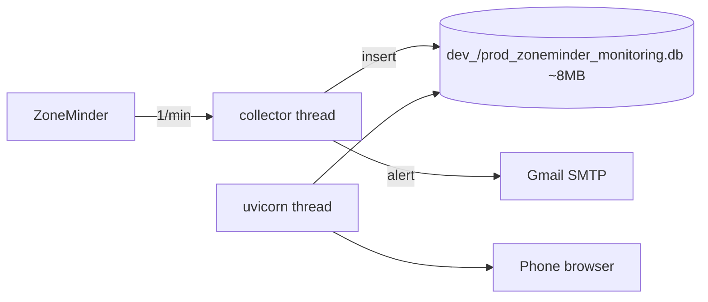

# NVR Monitor — Implementation Plan

## 1. What this is

1. A **sidecar notifier** for a ZoneMinder Docker Compose stack.
2. Polls ZoneMinder every 60s, emails when a camera's FPS stays low (network loss,
   camera offline, disk full).
3. The UI is a **self-verification instrument**, not analytics: it answers "is the
   collector still sampling, and did it miss anything?"
4. So gaps, staleness and missed samples matter more than pretty curves.
5. Every unit of logic gets a unit test. Network paths get a manual e2e checklist.

## 2. Scope

In scope:

1. Collect FPS + bandwidth per camera once per minute into SQLite.
2. Rolling 2-day window, pruned every tick.
3. Email on sustained low FPS with per-camera exponential backoff.
4. Record every alert attempt, including whether the email actually sent.
5. Single-page UI: every camera at a glance, zoom/pan buttons for touch, phone-friendly.
6. Pause/resume email notifications from the UI, protected by a passphrase.
7. Unit tests for all pure logic and the SQLite layer.
8. **One container** — collector thread + web app in a single process, database in a
   host folder.

Out of scope:

1. Multi-user auth, tenancy, retention beyond 2 days.
2. Automated tests for `send_gmail`, `login`, `authenticate`, `get` — replaced by
   the manual e2e checklist in §15.
3. Any external database.
4. HTTP-level tests via TestClient. HTTP handlers stay thin; the logic they call is
   extracted into pure functions and tested directly instead.

## 3. Limits that drive the design

1. 32 cameras × 1440 samples/day × 2 days = **92,160 rows**, **~8 MB** SQLite.
2. Per chart: 2,880 points × 2 series = **5,760 points**.
3. 32 charts at once = 32 instances × 5,760 points. Accepted as a one-time render on a
   flagship; not acceptable as a per-minute re-render, which is why there is no polling.
4. Conclusion 1: SQLite, because fixed cost (4 KB) beats any server DB (≥90 MB).
5. Conclusion 2: one page, browser-driven reload, **raw points — no server-side reduction**,
   so zooming never needs another request.
6. Target device: iPhone-class flagship. 32 charts there is a smoothness problem,
   not a feasibility problem.

## 4. Architecture



1. **One container, one Python process, two threads.**
2. `collector` thread — the tick loop; writes samples, sends mail.
3. `web` thread — uvicorn serving the JSON API and the static UI.
4. Started from a FastAPI `lifespan` handler, so `docker compose up` is the only entry point.
5. SQLite WAL: one writer, several readers, same file, no IPC.
6. If the collector thread ever dies, the web side stays up and the status strip reports
   `Collector: stale` — the self-check covers the merged process.
7. `docker-entrypoint.sh` runs before the app and always logs its decision. With `DEV=1`
   it seeds the bind-mounted `/data` database, and `tools/seed.py`'s own guard refuses if
   real (non-`SEED_`) samples are present. With `DEV=0` it does nothing and the app's
   `db.init()` creates an empty schema for the collector.

## 5. Files

| File | Purpose |
|---|---|
| `src/config.py` | env settings, `required()`, `flag()`, `tz()` |
| `src/db.py` | prefixed schema, `connect(path=None)`, queries |
| `src/monitor.py` | pure rules + `ZmClient` + tick loop |
| `src/web.py` | FastAPI app + payload builders + collector thread startup |
| `src/static/index.html` | single-page card grid + zoom overlay |
| `apexcharts-js/apexcharts.min.js` | already downloaded, v8.4.1 (§12) |
| `tests/conftest.py` | tmp database fixture |
| `tests/fixtures/monitors.json` | real `/api/monitors.json` dump for `extract()` tests |
| `tools/seed.py` | synthetic data so the UI can be built without ZoneMinder |
| `tests/test_config.py` | env parsing |
| `tests/test_db.py` | upsert, prune, ordering, persistence |
| `tests/test_notify.py` | alert decision rules |
| `tests/test_backoff.py` | backoff ladder |
| `tests/test_extract.py` | ZoneMinder response parsing |
| `tests/test_time.py` | slot alignment |
| `tests/test_payload.py` | series payload building |
| `tests/test_email_body.py` | email body construction |
| `tests/test_control.py` | passphrase check, pause flag |
| `tests/test_status.py` | status strip values |
| `Dockerfile` | single image, single process |
| `docker-compose.yml` | one service |
| `docker-entrypoint.sh` | seeds on first start when `DEV=1`, then execs CMD |
| `.dockerignore` | keeps the image small |
| `pytest.ini` | `testpaths = tests`, `pythonpath = src` |
| `pyrightconfig.json` | `extraPaths: ["src"]` so editors resolve `import config` from `tools/` too |
| `requirements.txt` / `requirements-dev.txt` | runtime / pytest |

Deleted: `run.sh`, `monitor_config.json`.

## 6. Data model

1. **Every table is prefixed `zoneminder_monitoring_`** via a `PREFIX` constant in `db.py`,
   so the file can share space with other tooling without collisions.
2. `zoneminder_monitoring_samples(source, ts, fps, bandwidth_kb)` — PK `(source, ts)`,
   `WITHOUT ROWID`.
3. `zoneminder_monitoring_cameras(source, resolution, next_at, step, last_seen)` —
   replaces the JSON state file.
4. `zoneminder_monitoring_notifications(id, ts, source, avg_fps, bandwidth_kb, step, email_ok, error)`.
5. `zoneminder_monitoring_settings(key TEXT PRIMARY KEY, value TEXT)` — `notify_enabled` = `1`
   (missing means `1`) and `seeded` = `1` when the database came from `tools/seed.py`.
   Nothing clears `seeded` automatically: only `tools/seed.py --clear` or a fresh database
   does, and the collector logs a warning on every start while it is set.
6. Database file name carries the environment: `dev_zoneminder_monitoring.db` when
   `DEV=1`, `prod_zoneminder_monitoring.db` otherwise. It sits in `DB_DIR`, which defaults
   to the project root (`./`) locally and `/data` in the container — the same folder as
   `docker-compose.yml`, never inside `src/`.
7. No secondary index; prune through the PK range per camera.
8. PRAGMAs: WAL, `synchronous=NORMAL`, `busy_timeout=5000`, `journal_size_limit=1MB`.
9. File reaches steady state after 2 days, then reuses pages. No `auto_vacuum`.
10. **Database-size history lives in RAM only** — a `deque(maxlen=168)` of hourly
    `(ts, bytes)` samples. Storing it in SQLite would grow the very file it measures.

## 7. Configuration

1. `ZM_URL`, `ZM_USER`, `ZM_PASSWORD` — ZoneMinder base URL and credentials.
2. `ZM_INSECURE=0` — `1` skips TLS verification.
3. `EMAIL_FROM`, `EMAIL_PASS`, `EMAIL_TO` — Gmail App Password.
4. `LOW_FPS_THRESHOLD=18`.
5. `SAMPLE_SECONDS=60`.
6. `RETENTION_DAYS=2`.
7. `DISPLAY_TZ=Asia/Ho_Chi_Minh`.
8. `DB_DIR=/data` — folder inside the container. The file name comes from `DEV`, so the
   volume holds `dev_…` and `prod_…` side by side without overwriting each other.
9. `DB_PATH` — full override of folder and name, used only by tests and one-off tooling.
10. `DB_HOST_DIR=./` — host folder bind-mounted to `/data`, defaulting to the folder that
    holds `docker-compose.yml`, so `dev_…db` / `prod_…db` appear right beside it and
    survive image rebuilds.
11. `PAUSE_PASSPHRASE` — required to pause/resume email notifications from the UI.
12. `DEV=0` — `1` switches the file name to `dev_…`, seeds fake data on container start,
    and shows the `SAMPLE DATA` bar. Production leaves it `0`; the collector creates and
    fills the `prod_…` file itself.
13. Truth is the environment; Compose uses `env_file: .env`.

## 8. Alert rules (unchanged behaviour)

`should_notify(samples, next_at, step, fps, now, *, threshold, min_samples, max_samples, backoff_h) -> Decision`

1. Append `fps`, keep last `max_samples`.
2. Fewer than `min_samples` → no decision.
3. Average ≥ threshold → reset `next_at=0`, `step=0`.
4. Average < threshold and `next_at` not due → quiet.
5. Average < threshold and `next_at` due (or `0`) → notify, advance backoff.
6. Ladder 1h → 2h → 4h → 8h → 24h; 24h is the ceiling.
7. `now` is a parameter, never `time.time()` inside → tests fast-forward without sleeping.
8. 3 samples required (≈3 min to confirm a drop).

Pause gate — one condition in `tick()`, right before the email block:

```
if not db.notify_enabled(conn):
    return
```

1. Sampling, `prune()` and backoff advancement all happen *before* that line, so pausing
   never stops data collection — the chart keeps working.
2. Resuming needs no catch-up: if a camera is still low and `next_at` has passed, the next
   tick sends the mail.
3. Reading the flag from SQLite each tick means the state survives restarts, and both
   containers see it immediately.

## 9. Chart data rules — send everything, once

1. `GET /api/data` returns **all raw 1-minute samples** for the whole retention window.
   No downsampling, no separate series endpoint, no follow-up request on zoom, and no
   `hours` parameter — the window is always whatever the collector keeps.
2. Payload: ~161 KB per camera (2 series × 2,880 points × ~28 B of JSON) → **~5 MB for
   32 cameras**.
3. `GZipMiddleware` on the FastAPI app brings that to ~500 KB on the wire. One line.
4. Because everything is already in the browser, **zoom and pan make zero server
   requests** — that is the whole reason to send raw data.
5. ApexCharts v8.4.1 handles 2,880 points per series: slow but correct. Accepted (§11).
6. Every point is a real sample, so tooltips never show invented values.

## 10. UI design — one page, no polling

1. **Status strip** — four indicators, computed once at load:
   | Indicator | Value | Source |
   |---|---|---|
   | `Collector` | alive / stale 4m | age of newest sample vs 2× `SAMPLE_SECONDS` |
   | `Cameras` | 26 / 32 | cameras with a sample in the last 2 intervals out of rows in `cameras` |
   | `Last email` | none / sent 14:02 / failed 14:02 | newest `notifications` row |
   | `Database` | 7.8 MB (+0.1 MB / 24h) | size of `.db` + `-wal`; hourly in-RAM samples, 7 days |
2. **Dot colours**: green healthy, red not, grey nothing to judge yet (`Last email: none`).
3. **Snapshot time** beside the strip ("as of 14:32:07") — a page that can't refresh
   itself has to say when it was taken.
4. **Conditional red bar** `SAMPLE DATA` across the top when `settings.seeded = 1`.
5. **Single page** — responsive grid of cards (1 column on phone, 2–3 on desktop).
6. **Each card**: name, resolution, current fps, status dot, one dual-axis chart
   (FPS left, KB/s right, dashed threshold). Nothing more.
7. **No timers, no polling, no refresh button.** Reloading is the browser's job.
8. **Tap a card → overlay** — a second chart instance configured entirely through
   ApexCharts options; **no CSS overrides of library internals**:
   - inline cards: `toolbar.show: false`, `zoom.enabled: false`. 32 visible toolbars would
     be ~190 icons of clutter, and touch drag-zoom fights page scrolling;
   - overlay: `toolbar.show: true`, `zoom.enabled: true`, `xaxis.type: 'datetime'`;
   - `toolbar.tools: { download: false, selection: true, zoom: true, zoomin: true,
     zoomout: true, pan: true, reset: true }`;
   - the overlay chart is created on tap and `destroy()`ed on close, so exactly one
     interactive chart exists at a time and no stale toolbar can linger;
   All data is already in the browser, so zoom and pan never touch the server.
9. **Pause control** — a passphrase input and one button. The button label *is* the
   `Email on drop` state (`Notifying` / `Paused`), so no separate indicator is needed.
10. Nothing else is interactive. No settings page, no auth, no user accounts.

Cut from the first draft, and why:

1. `Threshold` indicator — the dashed line on every chart already shows it.
2. `Email on drop` indicator — folded into the pause button, which shows state anyway.
3. `Data: LIVE` row — replaced by a bar that appears only when seeded. A permanent "LIVE"
   is noise, and noise trains you to stop reading the strip.
4. 5-min avg per card — it isn't what the alert uses (the rule averages 3 samples), so it
   invited the wrong inference.
5. Bandwidth number and backoff step per card — already visible (right axis, alert history).
6. Last-seen text per card — the line ending shows it; `Collector` covers the global case.
7. Range chips 1h/6h/24h/48h — the toolbar reaches any range, so the chips were a second
   way to do the same thing.
8. `?hours=` parameter — the window is always the retention window.

## 11. Render cost — accepted

1. ~32 charts × 2 series × 2,880 points paint in roughly 3–5 s on a flagship, once per
   page load. Accepted: no polling, no re-render, nothing to keep smooth.
2. ApexCharts settings required to stay in that range: `dataLabels.enabled=false`,
   `markers.size=0`, `animations.enabled=false`, `tooltip.shared=true`,
   `stroke.width=1`, `xaxis.type='datetime'`.
3. `GZipMiddleware` keeps transfer at ~500 KB instead of ~5 MB.
4. No CDN, no webfonts — system font stack, vendored JS only.
5. ApexCharts injects its own styles; **there is no CSS file to ship**.

### Library comparison (mobile, 2 series per chart)

| Option | Size | Type | 400 pts | 2,880 pts | Built-in zoom/drag | Touch |
|---|---|---|---|---|---|---|
| **ApexCharts 4** | ~500 KB | SVG | fine | usable, slower | yes + toolbar | good, pinch needs custom |
| Chart.js 4 + decimation | ~205 KB + 20 KB | canvas | fine | fine | needs zoom plugin | needs hammer.js |
| uPlot 1.6 | ~48 KB | canvas | fine | very fast | yes, native | yes (pinch + drag) |

1. The 400-point payload (§9) removes most of the pressure, so all three are viable.
2. **ApexCharts chosen** — built-in datetime axis, zoom, pan, toolbar and dark theme
   mean the least JS to write, which is what "lightweight project" actually buys.
3. Its SVG cost only bites above ~2,000 points *and* with many instances — both
   already designed out.
4. Fallback if a phone still stutters on raw-zoom: swap the card charts to **uPlot**
   (48 KB, canvas, 10–50× faster at high point counts). The API contract in §9 stays
   identical, so it's a UI-only change.

## 12. Assets — already downloaded

1. `apexcharts-js/apexcharts.min.js` — **ApexCharts v8.4.1**, ~945 KB, single file. Already
   in the repo; no download needed.
2. **There is no CSS file.** ApexCharts injects its own styles; the installation docs list
   only `dist/apexcharts.min.js`. Do not look for `apexcharts.css`.
3. Serve the folder as a static mount (`/apexcharts-js`) or COPY it into the image. No
   build step, no bundler, no npm.
4. The default bundle is enough: line series, axes, tooltips, legend, toolbar and zoom are
   all included. No optional imports.
5. If you ever re-download, pin the same version and keep it as one file.

## 13. Implementation phases (web first)

**Rule: a phase isn't done until its tests are green.**

### 13.0 monitor.py audit — what survives, what gets rewritten

Keep, it works — do not touch the internals:

1. `send_gmail()` — `SMTP_SSL` on 465, `login`, `send_message`. Proven against Gmail.
2. `login()` / `get()` — ZoneMinder JWT flow against `/api/host/login.json` and
   `/api/monitors.json`. Proven against the real instance.
3. `extract()` field mapping — `Width`/`Height`, `CaptureFPS`, `CaptureBandwidth/1024`.

Rewrite — the logic problems:

1. **State is keyed on `Path` or `Type`, not `Monitor.Id`.** Two monitors sharing a path
   overwrite each other's samples and backoff. Key on the monitor id.
2. **Backoff lives in `monitor_config.json`, and a corrupt file returns `{}` silently** —
   which resets every backoff and produces an alert storm. SQLite removes the failure mode.
3. **`sys.exit()` inside `login()`** — one transient ZoneMinder hiccup kills the process.
4. **The refresh token returned by `login({"token": refresh})` is discarded**, and the new
   expiry is hardcoded to 3600 instead of using `access_token_expires`.
5. **`should_notify()` is impure** — reads module globals and calls `time.time()`, so it
   cannot be tested. `now` and the window become parameters.
6. **`MIN_SAMPLES == MAX_SAMPLES == 3`**, so the "rolling average" never actually smooths —
   the confirmation window *is* the smoothing window. Behaviour kept, constants made
   separate and explicit.
7. **`print()` instead of logging** — no levels, no timestamps, lost in Docker logs.
8. **`DISPLAY_TZ` is documented but unused**; `VN_TZ` is hardcoded +7.
9. **No `requests.Session`** — a new TLS handshake on every call.
10. **Docstring says threshold 10, code uses 18** — drift already happened once.

What the real response confirms (`sample_zoneminder_response.txt`):

1. `CaptureFPS` is a **string** (`'30.49'`), not a number — `float()` coercion is load-bearing.
2. `Monitor.Path` is a full RTSP URL; using it as the state key means 50-character keys and
   collisions whenever two monitors point at the same stream.
3. `Monitor.Name` (`'Monitor-1'`) is the human label and the right thing to display.
4. `Monitor_Status.Status` reports `Connected` / `Disconnected`, so a dead camera can be
   detected from status, not only from a zero FPS sample.
5. `Monitor.Enabled` can be `0` while `CaptureFPS` is 30.49 — do not gate on `Enabled`.
6. The dump contains `Monitor.Pass` and RTSP credentials: it must never be committed. It is
   in `.gitignore`; the fixture is a sanitized JSON copy at `tests/fixtures/monitors.json`.

Sample response: keep a real `/api/monitors.json` dump at `tests/fixtures/monitors.json`
and parametrize the `extract()` tests over its actual entries instead of inventing dicts.

### Phase 1 — Scaffolding, storage, seed data

1. Create `src/config.py` — settings, `required()`, `flag()`, `tz()`.
2. Create `src/db.py` — prefixed schema, `connect(path=None)`, `init()`, queries.
3. Create `requirements.txt`, `requirements-dev.txt`, `pytest.ini`.
4. Create `Dockerfile`, `docker-compose.yml`, `.dockerignore`, `docker-entrypoint.sh`
   **first**, with `src/web.py` as a minimal placeholder so `docker compose up` works
   immediately. `DEV=1` seeds the bind-mounted database on first start; `DEV=0` leaves
   creation to the app.
5. Create `tools/seed.py` — fills a database with synthetic data so the UI can be built
   without ZoneMinder running. Everything it writes must be **obviously fake**:
   - camera names `SEED_cam_01` … `SEED_cam_32`;
   - flat baseline **100.00 fps** and **1024.0 KB/s** (exactly 1 MB/s) — impossible for a
     real camera, so a single glance at any chart says "this is not production";
   - two cameras dip to ~5 fps for 20 minutes and one has a 30-minute gap, so threshold
     crossings, notification rows and chart gaps are all visible;
   - sets `settings.seeded = 1`, which the UI turns into a red `SAMPLE DATA` banner (§10);
   - refuses to run if the samples table already holds any `source NOT LIKE 'SEED_%'`
     unless `--force`, so it cannot pollute real history by accident.
6. Write `tests/conftest.py` (tmp DB fixture), `tests/test_config.py`, `tests/test_db.py`.
7. Done when: `pytest` green with no env vars set,
   `python tools/seed.py --cameras 32` produces a populated database, and
   `docker compose up --build` serves `GET /api/data?only=status`.

### Phase 2 — Web and dashboard first

The riskiest unknown is 32 charts × 2,880 points on a phone. Build the observability tool
first, run it against seeded data, and every later phase can be verified by looking.

1. Create `src/web.py` — **two API routes only**:
   - `GET /api/data[?only=status]` → `{as_of, status, cameras, series, notifications}`,
     every section read inside **one SQLite transaction** so the snapshot is consistent;
     `only=status` returns just the strip for cheap script checks;
   - `POST /api/control` → `{passphrase, enable}` → returns the new `notify_enabled`.
   Plus `/` for the HTML page and a static mount for `apexcharts-js/` and `static/`.
   `GZipMiddleware` on the app.
2. Add pure builders `build_series_payload(rows, threshold, tz)`,
   `build_status_payload(...)`, `db_size_trend(samples, now)` and
   `check_passphrase(given, expected)` (`secrets.compare_digest`).
3. `POST /api/control` validates the passphrase before touching the settings row; returns
   401 on mismatch, never echoes the passphrase back, and returns the new state on success
   so the button updates without a refetch. Current state is read from `/api/data`, not a
   separate route.
4. Create `src/static/index.html` — status strip, card grid, ApexCharts zoom overlay, pause box
   (§10), loading `apexcharts-js/apexcharts.min.js` directly.
5. Write `tests/test_payload.py`, `tests/test_status.py`, `tests/test_control.py`.
6. Done when: browser shows 32 seeded cameras, status strip is correct, zoom/pan works on
   a phone, first paint measured and written down.

### Phase 3 — Alert rules, pure (can run parallel with Phase 2)

1. Add to `src/monitor.py`: `Decision`, `should_notify`, `next_backoff`, `extract`, `slot_for`.
2. All pure — no DB, no clock, no network, no import-time side effects.
3. Write `tests/test_notify.py`, `tests/test_backoff.py`, `tests/test_extract.py`
   (fixture-driven), `tests/test_time.py`.
4. Done when: full backoff ladder covered, `extract()` passes against the real ZoneMinder
   fixture, and `import monitor` works with no env set.

### Phase 4 — Collector wiring (keeps the proven I/O)

1. Move `send_gmail()` and the ZoneMinder client into the new shape — internals unchanged,
   return values and retry behaviour now exceptions instead of `sys.exit`.
2. Add `tick(conn, client)` and `deliver(conn, slot, alerts)`; sample the database size
   hourly into the in-RAM 7-day `deque`; apply the pause gate before `deliver()`.
3. Start the loop from the FastAPI `lifespan` hook so one process serves both roles.
4. Add `build_email_body(alerts, ts, threshold)` + `tests/test_email_body.py`.
5. Delete `load_state`, `save_state`, `STATE_FILE`, `monitor_config.json`.
6. Done when: with the dashboard open, real samples appear and the strip flips to
   `Collector: alive`; §15 checklist passes.

### Phase 5 — Packaging and release

1. `.env.example` — add `RETENTION_DAYS`, `DISPLAY_TZ`, `DB_HOST_DIR`, `PAUSE_PASSPHRASE`.
2. Delete `run.sh`. Rewrite `README.md` (what it is, env table, compose usage, tests).
3. Rebuild the image from scratch and confirm history survives.
4. Done when: §16 verification passes end to end.

## 14. Unit test inventory (~74 cases)

`test_notify.py`

1. Fewer than `min_samples` → no notify.
2. Average ≥ threshold → no notify.
3. Average < threshold, `next_at=0` → notify.
4. Average < threshold, `now < next_at` → no notify.
5. `now == next_at` → notify (boundary).
6. Average exactly == threshold → no notify (boundary).
7. `fps=0` counts as low.
8. Window keeps only the last `max_samples`.
9. Returned samples are in chronological order.
10. Invariant: notify implies average < threshold.

`test_backoff.py`

1. First alert → `next_at = now + 3600`, `step = 1`.
2. Second → `+7200`, `step = 2`.
3. Third → `+14400`, `step = 3`.
4. Fourth → `+28800`, `step = 4`.
5. Fifth → `+86400`, `step` stays 4.
6. Sixth → still `+86400` (ceiling holds).
7. Healthy sample → `next_at = 0`, `step = 0`.
8. Recovery then new drop → alerts immediately, not after 24h.
9. `now` far past `next_at` → exactly one alert.
10. `next_at` past but average healthy → quiet and reset.

`test_extract.py`

1. `Deleted` → `None`.
2. `Path` preferred over `Type`.
3. Falls back to `Type` when `Path` missing.
4. `Width`x`Height` → `1920x1080`.
5. Missing dimensions → `-`.
6. Missing `Monitor_Status` → fps 0.0, bandwidth 0.0.
7. Bandwidth bytes → KB, 1 decimal.
8. JSON `null` fields don't raise.

`test_time.py`

1. `slot_for` truncates to the interval.
2. Idempotent (same slot for the same interval).
3. Two timestamps inside one interval share a slot.

`test_payload.py`

1. Rows grouped by source.
2. Resolution carried through.
3. fps rounded to 2dp, bandwidth to 1dp.
4. `threshold` and `tz` present.
5. Cameras sorted by source.
6. Empty rows → empty camera list.

`test_email_body.py`

1. Header states count and threshold.
2. One block per camera.
3. fps 2dp, bandwidth 1dp.
4. Timestamp rendered in `DISPLAY_TZ`.
5. No alerts → no body emitted.

`test_config.py`

1. `required()` returns the value.
2. Missing var → `SystemExit`.
3. Empty / whitespace var → `SystemExit`.
4. `flag()` true for `1`, `true`, `yes`, `TRUE`.
5. `flag()` false for `0`, absent, garbage.
6. Defaults applied when unset.

`test_control.py`

1. Correct passphrase → allowed.
2. Wrong passphrase → rejected.
3. Empty / `None` passphrase, or unset `PAUSE_PASSPHRASE` → rejected.
4. `set_setting("notify_enabled", "0")` then read back through a new connection →
   still disabled, i.e. survives a restart.

`test_status.py`

1. `Collector: alive` when the newest sample is younger than 2× interval.
2. `Collector: stale` when it is older, and the age is reported in minutes.
3. `Cameras: 26 / 32` when six cameras have no sample in the last 2 intervals.
4. `notify_enabled = 0` → status reports Paused, which becomes the button label.
5. `Last email: none` when the `notifications` table is empty.
6. `Last email: sent 14:02` vs `failed 14:02` chosen from `email_ok`.
7. `Database: 7.8 MB` from the newest size sample, `+0.1 MB / 24h` from the sample 24h back.
8. Only one size sample → delta rendered as `-`.
9. `db_size_trend` ignores samples older than 7 days.
10. `seeded=1` → `status.seeded` true; absent or `0` → false.
11. `record_db_size` appends the first sample, skips inside the interval, appends after
    it, and ignores a zero size.

`test_db.py`

1. Upsert same `(source, ts)` → one row, new values.
2. `recent_fps` ascending and limited.
3. `save_camera` insert then update.
4. `next_at`/`step` survive a new connection.
5. `prune` keeps the cutoff boundary.
6. `series` ordered by source then ts, carries resolution.
7. `camera_overview` returns the latest sample per camera.
8. Notifications returned newest first.
9. `status` reports stale seconds for a fresh sample.
10. `set_setting` / `get_setting` round-trip, missing key → default.

## 15. Manual e2e checklist (replaces network tests)

Run once after Phase 4, again before release:

1. Wrong `ZM_PASSWORD` → clear error in logs, container stays up, retries next minute.
2. ZoneMinder stopped for 2 ticks → errors logged, no crash, resumes when ZM returns.
3. Valid credentials → one line per camera, `raw=`, `avg=`, `bw=` values plausible.
4. Force a low-FPS camera → email arrives within 3 minutes of the drop.
5. Wrong Gmail App Password → `notifications` row has `email_ok=0` and an error text.
6. Recovered camera → backoff resets; next drop alerts immediately.
7. `docker compose restart collector` mid-backoff → `step` preserved.
8. Pause with the correct passphrase → no email, but `samples` keeps growing.
9. Pause with a wrong passphrase → 401, still notifying.
10. Resume → the next low tick alerts again without restarting anything.
11. Rebuild the image (`docker compose build --no-cache`) → history still present,
    proving the database lives in the host folder, not the container.

## 16. Verification

1. `python3 -m pytest -q` green with **no env vars set**.
2. `docker compose up --build -d` → one service running, healthcheck green.
3. `docker compose logs -f collector` → one tick per minute, no tracebacks.
4. `curl -s 'localhost:9080/api/data?only=status'` → `stale_seconds` < 61,
   `notify_enabled` true, `cameras_reporting` equal to the camera count, counts rising.
5. Phone browser → pause button reads `Notifying` and strip shows `Collector: alive`;
   all 32 cards paint on load (~1 s); page stays static; tap opens the zoom overlay.
6. Stop the collector 3 minutes, reload → `Collector: stale 3m`, `Cameras: 0 / 32`,
   and the chart shows a visible gap.
7. Pause notifications from the UI → the control reads "Paused", `samples` still grows,
   no new `notifications` rows.
8. `docker compose down && up -d` → history survives.
9. Pause, then `docker compose restart` → still paused (flag is in SQLite).

## 17. Decisions

1. **SQLite** — 4 KB fixed cost vs ≥90 MB for any server DB; 92k rows needs no compression.
2. **ApexCharts v8.4.1** — built-in datetime zoom/pan/toolbar for the least custom JS;
   handles 2,880 points per series, just slowly.
3. **One container, two threads** — saves ~40–60 MB of duplicated interpreter and imports,
   one deploy unit, and lets the db-size history live in RAM because both sides share a
   process. Risk is crash coupling; the status strip surfaces a dead collector thread.
4. **Raw payloads, no reduction** — zoom and pan then need zero server requests, and
   `GZipMiddleware` cuts 5 MB to ~500 KB. Accepted cost: 3–5 s first paint.
5. **Single page, no polling** — all 32 cameras on one screen, loaded once; the browser
   handles reloading. No timers in the app.
6. **Backoff in SQLite, not JSON** — transactional and restart-safe.
7. **3-sample confirmation kept** — matches today's behaviour; revisit after real data.
8. **Collector survives tick failures** — a logged error beats a restart loop.
9. **No `idx_samples_ts`** — would cost ~30% of table size for a prune the PK already handles.
10. **Pause is one `if`** — a `notify_enabled` row checked in `tick()` just before the
    email block. Passphrase lives in `.env`, same handling as the Gmail password.
11. **Database in a host folder, not a named volume** — survives `docker compose down -v`,
    image rebuilds and `docker system prune`; it's just a file you can copy.
12. **`zoneminder_monitoring_` prefix on every table and the file name** — no collision
    with anything else that may share the folder.
13. **Seed data must look fake** — `SEED_` names, 100 fps, 1024 KB/s, plus a
    `settings.seeded` flag that paints a `SAMPLE DATA` bar. Numbers alone are too easy to
    skim past on a chart.
14. **Two API routes, not five** — `GET /api/data` returns the whole page snapshot from one
    transaction, `POST /api/control` changes the flag. Five separate endpoints would each
    open their own connection and could disagree on the snapshot time, which matters on a
    page whose purpose is self-verification. `?only=status` covers cheap health checks.
15. **Minimal UI** — four strip indicators, four fields per card, one control. Everything
    removed had a duplicate elsewhere on the same screen.
16. **`DEV` lives in the entrypoint, not in Python** — production code has no dev branch.
    The script always logs `DEV` and `DB_PATH` so a missing log line proves the image is
    stale rather than the flag being ignored.
17. **No CSS overrides of library internals** — no selectors matching `.apexcharts-*`,
    no `transform: scale()` on icon SVGs, no forcing layout on library elements. Behaviour
    comes from options and from creating the right instance for each context.
18. **Tests per phase** — a phase is done when its tests are green, not when code is written.

## 18. Open items

1. **Sidecar networking**: (a) attach to the ZoneMinder compose network,
   `ZM_URL=http://zoneminder:8080/zm`; (b) `extra_hosts: host.docker.internal:host-gateway`;
   (c) `network_mode: host` on the collector.
2. **Pinch-zoom** — ApexCharts' toolbar handles zoom/pan without custom touch code;
   add pinch only if the toolbar proves awkward on a phone.
3. **ApexCharts version** — v8.4.1 is already vendored; keep it pinned.
4. **Passphrase brute force** — the pause endpoint is LAN-only and unauthenticated apart
   from the passphrase. Option A: leave it (hobby scope). Option B: add a 5-failure /
   60-second in-memory lockout, ~10 lines.
5. **Later** — `/api/self-check`: replay 24h through `should_notify` and report
   "would have alerted N times". Turns the dashboard into an active audit.
